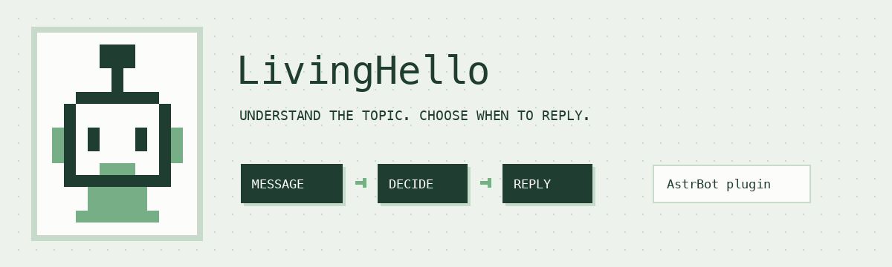
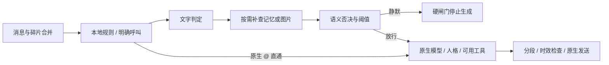

<div align="center">

# LivingHello

**让机器人看懂话题，再决定是否接话。**



[](https://docs.astrbot.app/)
[](CHANGELOG.md)
[](docs/README.md)

</div>

LivingHello 在 AstrBot 主回复生成前判断群聊消息是否适合参与：先检查本地规则，再按需使用文字、记忆和图片背景。通过后由原生主模型及人格生成回复，并管理碎片等待、分段、引用与 @。可独立使用，也可与从绫配套。正式名称已由 AtGuard 更改为 LivingHello，既有插件 ID、接口和数据目录继续兼容。

## 能做什么

| 你想做的事 | LivingHello 的处理 |
| --- | --- |
| 减少群聊插话和无效生成 | 小模型先判定；硬闸门静默时停止主回复生成 |
| 听完连续几条消息再回复 | 同一会话、同一用户续发重置安静期，合并为一次输入 |
| 图片和记忆有助于理解话题 | 按需补查；图片观察与成功查询证据可传给主回复 |
| 统一回复格式 | 原生配置管理模型段落、多消息发送、最大段数；首条正文按开关引用或 @ |
| 在一页管理模型和人格 | 选择 AstrBot 原生配置，展开模型、人格、图片理解及文本排版分组 |
| 看清机器人为何回复或静默 | 四页控制台、可点击流程节点、文字试跑和最近判定详情 |

## 第一次使用

> 先选定一个成本合适的判定小模型，再使用默认硬闸门。文字试跑使用已保存配置，会产生模型 API 用量。

1. 在 AstrBot 插件管理中通过仓库地址安装：

   ```text
   https://github.com/AKIhunter/astrbot_plugin_livinghello
   ```

2. 打开 **插件详情 → guard**；在 **判定设置** 选择判定小模型，保留默认阈值 `65` 和 `enforce` 模式。
3. 在 **回复与私聊** 选择目标原生配置，按需调整对话模型、人格和分段，点击底部 **保存更新**。原生配置选择决定编辑目标；会话实际使用哪个配置仍由 AstrBot 分配。
4. 在 **流程与试跑** 输入一句消息和必要背景，查看每个节点的实际依据。再到测试会话检查真实接话和发送效果。

图片判定按需配置视觉模型；判定模型留空会跟随会话当前模型，成本也会随其变化。详细操作见[使用指南](docs/usage.md)。

## 目录

- [使用模式](#使用模式)
- [控制台与配置](#控制台与配置)
- [判定与生成流程](#判定与生成流程)
- [配套插件](#配套插件)
- [常见问题](#常见问题)
- [兼容性与安全](#兼容性与安全)
- [使用指令与接口](#使用指令与接口)
- [更新日志](#更新日志)
- [完整文档入口](docs/README.md)

## 使用模式

| 模式 | 对需要判定的消息如何处理 | 适用情况 |
| --- | --- | --- |
| `enforce`（默认） | 静默时停止主回复生成；图片异常兜底仍可能调用主模型做判定 | 日常运行 |
| `shadow` | 记录判定结果，继续原生生成流程 | 对比新模型或阈值；不能用来验证“静默时不生成” |
| `legacy` | 先判定，仍生成主回复，再清空应静默的正文 | 兼容旧行为，会消耗生成用量 |
| `off` | 关闭参与判定及称呼前缀注册 | 回复方式、撤回和私聊等待仍由独立开关控制 |

原生 @ 当前机器人有直接放行路径，不需要小模型评分。私聊参与过滤默认关闭。普通群消息仍依赖 AstrBot 已启用的主动回复策略进入生成链路，插件不保证每条消息都有判定记录。

## 控制台与配置

| 一级页 | 主要内容 |
| --- | --- |
| 运行概览 | 闸门模式、今日/累计统计、分数分布、阈值扫描、最近判定 |
| 判定设置 | 小模型、视觉和兜底、上下文/记忆、预算和时限 |
| 回复与私聊 | 碎片等待、引用/@、模拟耗时、撤回、原生模型/人格/分段、图片相关设置 |
| 流程与试跑 | 判定图、生成图、文字试跑、节点输入与依据 |

配置标题右侧 `?` 显示解释及两个示例；顶部参数手册支持搜索。改动后底部显示统一保存栏，切页保留草稿。保存不清零统计，失败部分保留草稿。配置默认值和保存范围见[配置参考](docs/configuration.md)。

分段有两个独立层次：“仅对模型结果分段”要求模型组织段落，“启用分段回复”负责拆成多条消息。第二句号和分段词默认关闭，最大段数 `0` 表示不限。操作示例见[分段设置](docs/usage.md#设置分段回复)。

## 判定与生成流程



分数是参与适合度，不是事实正确率。通过还须 `act=reply`、`understood=true` 且没有停口、互聊、已答或背景不足等否决。判定异常默认静默；视觉异常才按开关尝试支持图片的会话主模型兜底一次，正常视觉静默不会触发兜底。

流程页的生成图表示后续计划；文字试跑不生成正文、不读取真实用户记忆、不上传图片、不发送消息。真实工具结果和发送记录才可证明检索、记忆回写及回复发生。[完整流程、缓存与失败边界](docs/architecture.md)。

## 配套插件

- **从绫**：保持其感知、情绪、关系和记忆设置；配套版本须在门禁后执行人格准备，并上报当前事件爬楼耗时。[配套约定](docs/architecture.md#从绫配套)。
- **LivingMemory**：可提供按会话/人格检索的背景。长期写入须实际启用 `agent_tools.enable_memorize_tool`，确认存在 `memorize_long_term_memory`，并由主模型调用。
- **多 API 模型路由**：下拉可选择已注册 provider，判定列表支持相应上游选择。原生回退模型列表只接受真实注册的 provider。
- **BiliBot**：页面可桥接其动态配图的全局 AI 文生图参数；普通聊天是否具备绘图工具仍由实际工具接入决定。

## 常见问题

**为什么 @ 了机器人，最近判定里没有评分？**

原生 @ 直接放行，不伪造小模型记录。碎片等待中的旧触发、其他插件提前拦截也可能不产生参与判定记录。

**为什么降低阈值还是不回复？**

语义否决、理解状态、预算和时效均独立于阈值。先查看实际记录原因及流程节点，再调整模型或背景。

**为什么分段后仍是一条消息？**

检查“启用分段回复”和会话实际使用的原生配置。模型段落开关只控制输出组织；平台发送限制、原生长文本阈值及最大段数也会影响结果。

**为什么读完从绫历史没有当前答复？**

检查钩子顺序、当前事件是否真实上报准备耗时，以及 `context_changed` / `message_expired`。有效期适配不绕过新消息取消或正文生成失败。

**文生图、文本转图和图生图有何区别？**

图片理解用于读图，原生 `t2i` 把文字排版成图，BiliBot 文生图用于 AI 动态配图。当前宿主没有独立图生图入口，页面显示不可用。

**旧安装需要迁移吗？**

保留技术 ID `astrbot_plugin_at_guard`，不用搬数据。已保存配置优先于新默认值；手动选择人格并保存后才固定人格。

更多操作与排查见[使用指南](docs/usage.md)。

## 兼容性与安全

要求 AstrBot **4.29.1 及以上**；原生保存与流水线接口缺失时明确报错。平台引用、@、TTS、媒体和条数限制由宿主及适配器决定。

判定记录可能包含消息正文、上下文与模型输入，应限制数据目录访问。发布时排除用户配置、密钥、数据库、日志和备份。BiliBot 密钥只显示是否配置，需回原插件编辑。试跑和观察模式仍可能产生 API 费用。

离线回归验证代码分支和交接规则，不能证明真实群聊语义准确率，也不能据此声称固定的线上 Token 节省比例。

## 使用指令与接口

| 入口 | 用途 |
| --- | --- |
| `/智能过滤统计` | 查看当前模式与今日统计，沿用 AstrBot 命令前缀设置 |
| 插件详情 → `guard` | 配置、记录与流程试跑 |
| `at_guard_score(text)` | 可选配套打分，返回 `{"score": 0..100}` 或 `None`；会使用判定模型 |
| `get_fixed_native_persona_id(umo)` | 配套插件读取目标原生配置的固定人格 |

WebUI 路由和开发验证入口见[开发与维护](docs/development.md)。

## 更新日志

当前 **2.7.0**：LivingHello 更名、四页控制台、流程节点试跑、原生模型与固定人格桥接。本次整理补齐文档索引、像素图标和 Banner，将测试集中到 `tests/`，运行功能版本保持不变。[完整更新日志](CHANGELOG.md)。
